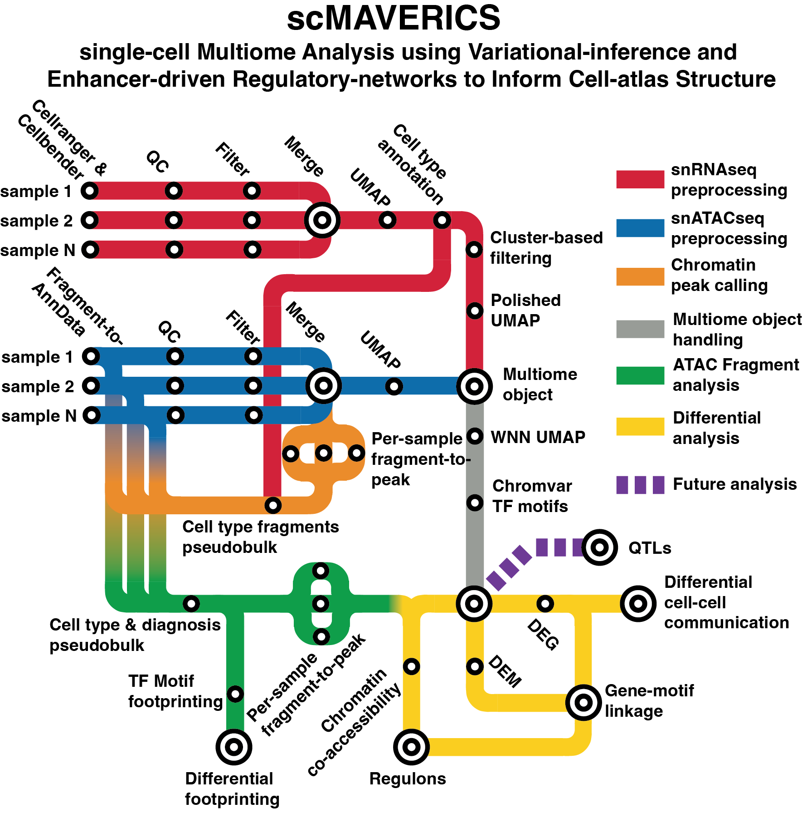

# scMAVERICS


## single-cell Multiome Analysis using Variational-inference and Enhancer-driven Regulatory-networks to Inform Cell-atlas Structure

Disclaimer: This pipeline is built to run with large (>100 sample) datasets on the Slurm HPC at the NIH (Biowulf).

This work is now published in [*Cell Reports*](https://doi.org/10.1016/j.celrep.2026.117110)! Please use this publication for citation.

➡️ Tutorial on how to use this pipeline at https://scmaverics.readthedocs.io/en/latest/

> **🚧 Main branch is currently being upgraded to incorporate methods tested out in SN, PFC_PSP, and PCA branches. Please use version 1.0.0 that is found in our *Cell Reports* paper until version 1.2 goes live.**

Focus on the analysis, not the processing.

## Pipeline



### Snakemake pipeline
Begin by cloning the scMAVERICS repo with
```
git clone https://github.com/NIH-CARD/scMAVERICS.git
cd scMAVERICS
```

There is no need to worry about python environments. All scripts in the Snakemake-enabled pipeline use singularity (apptainer) and snakemake, with singularity images (`.sif` files) being pulled from Quay.io. Each step of the analysis assumes this is being run on a Slurm-enabled HPC, where GPUs and large-memory nodes are available. 

Large memory nodes are required for handling large (>50) sample multiome datasets and GPUs are required for running samples in a timely manner. 

### Local environment
However, if you don't have access to an HPC or have not enough samples to justify running the entire pipeline, the environment used for most steps can be recreated with:

```
git clone https://github.com/NIH-CARD/scMAVERICS.git
cd scMAVERICS
conda create -n multiome
conda activate multiome
pip install -r requirements.txt
```

This environment is used in example analysis in Jupyter notebooks, beginning with [snRNAseq analysis](https://scmaverics.readthedocs.io/en/latest/snRNAseq/). 

