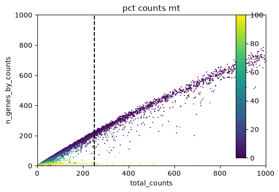
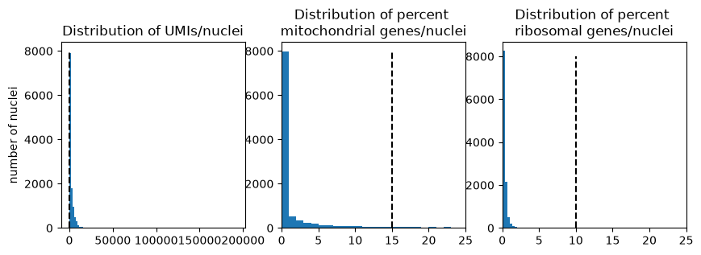

## scMAVERICS - snRNAseq processing

This tutorial runs through taking the output of Cellbender (which should be run outside of a notebook) for a handful of samples and integrate the samples into a cell type annotated object. If the dataset in question is only transcriptomics, not multiomics, this analysis should be sufficent.

This section borrows heavily from the [scanpy](https://scanpy.scverse.org/en/1.12.x/) (version 1.11.5) introduction tutorial, with modifications made for incorporating packages
- [scVI](https://scvi-tools.org/) (version 1.4.2)
- [decoupler](https://decoupler.scverse.org/en/stable/) (version 2.1.6)
- [scrublet](https://github.com/swolock/scrublet)

This notebook and all others, can be created from the instructions [here](https://github.com/NIH-CARD/scMAVERICS/tree/main#local-environment)

## Package and data loading


```python
# Import standard python packages
import numpy as np
import pandas as pd
import scipy

# Plotting packages
import matplotlib.pyplot as plt
import seaborn as sns

# Specialized single cell packages
import anndata as ad
import scanpy as sc
import decoupler as dc
import scvi
```

### Define working and data directories


```python
data_dir = '/data/CARD_singlecell/Brain_atlas/SN_Multiome/'
work_dir = '/data/CARD_singlecell/SN_atlas/' 
```

### Load metadata

As stated before, metadata should be imported, for visualizing parameters, 


```python
metadata_df = pd.read_csv(work_dir + 'input/metadata.csv')
metadata_df
```


<div>
<style scoped>
    .dataframe tbody tr th:only-of-type {
        vertical-align: middle;
    }

    .dataframe tbody tr th {
        vertical-align: top;
    }

    .dataframe thead th {
        text-align: right;
    }
</style>
<table border="1" class="dataframe">
  <thead>
    <tr style="text-align: right;">
      <th></th>
      <th>Sample_ID</th>
      <th>Use_batch</th>
      <th>Age</th>
      <th>PMI</th>
      <th>Sex</th>
      <th>Brain_bank</th>
      <th>Primary Diagnosis</th>
    </tr>
  </thead>
  <tbody>
    <tr>
      <th>0</th>
      <td>6178</td>
      <td>6</td>
      <td>68</td>
      <td>22.5</td>
      <td>Male</td>
      <td>Human Brain and Spinal Fluid Resource Center</td>
      <td>control</td>
    </tr>
    <tr>
      <th>1</th>
      <td>3284</td>
      <td>1</td>
      <td>78</td>
      <td>11.5</td>
      <td>Female</td>
      <td>Human Brain and Spinal Fluid Resource Center</td>
      <td>control</td>
    </tr>
    <tr>
      <th>2</th>
      <td>6384</td>
      <td>3</td>
      <td>50</td>
      <td>22.3</td>
      <td>Female</td>
      <td>Human Brain and Spinal Fluid Resource Center</td>
      <td>PD</td>
    </tr>
    <tr>
      <th>3</th>
      <td>5638</td>
      <td>3</td>
      <td>77</td>
      <td>19.3</td>
      <td>Male</td>
      <td>Human Brain and Spinal Fluid Resource Center</td>
      <td>PD</td>
    </tr>
  </tbody>
</table>
</div>


### Define parameters


```python
# Define keys
sample_key = 'Sample_ID'
batch_key = 'Use_batch'

# Define list of samples
samples = metadata_df[sample_key].astype(str)
batches = metadata_df[batch_key].astype(str)

# Cell cycle file
cell_cycle_gene_file = work_dir + 'input/lab_cell_cycle_genes.txt'

# QC thresholds
mito_thresh = 15
ribo_thresh = 10
doublet_thresh = 0.15
min_genes = 250

num_hvgenes = 2000
```

# Sample preprocessing

This analysis begins after running cellbender. As this process is GPU/CPU intensive and takes a long time to run, it is best done via terminal with the command:
```
cd path/to/sample/outs/

cellbender remove-background \
--input raw_feature_bc_matrix.h5 \
--output cellbender_gex_counts_filtered.h5 \
--checkpoint ckpt.tar.gz --cuda --posterior-batch-size 64
```

This will run for a while for each sample. Make sure you are in the desired sample folder when running, as the `ckpt.tar.gz` file will be created in the current working directory, and checkpoint files will overwrite one another, leading to errors and stalled Cellbender runs.

## Preprocessing

This section iterates over the outputs of Cellbender, preprocessing, QC-thresholding, merging samples, performing sex checks, and 

### rna_preprocess

First the 


```python
# Define input files
step_1_files = [data_dir + f'/batch{batches[i]}/Multiome/{samples[i]}-ARC/outs/cellbender_gex_counts_filtered.h5' for i in range(len(samples))]
# Define the output files (corresponding to sample)
step_2_adatas = {}
```


```python
# Iterate over the samples
for i, sample in enumerate(samples):

    print(f'Working through sample {sample}')

    # Load the Cellbender file
    adata = sc.read_10x_h5(step_1_files[i])
    # Ensure unique variable names (MUST BE DONE FIRST!)
    adata.var_names_make_unique()

    print(' -> Sample loaded')

    # Make a raw counts layer
    adata.layers['counts'] = adata.X.copy()
    adata.raw = adata

    # Add mitochondrial and ribosomal markers
    adata.var['mt'] = adata.var_names.str.startswith('MT-')
    adata.var['rb'] = adata.var_names.str.startswith(('RPL', 'RPS'))

    # Calculate QC metrics
    sc.pp.calculate_qc_metrics(adata, qc_vars=['rb', 'mt'], percent_top=None, log1p=False, inplace=True)

    print(' -> QC calculated')

    # Add metadata to the AnnData object directly from the metadata dataframe
    for key in metadata_df.to_dict():
        adata.obs[key] = metadata_df[key]

    # Calculate cell cycle
    cell_cycle_genes = [x.strip() for x in open(cell_cycle_gene_file)]
    s_genes = cell_cycle_genes[:42]
    g2m_genes = cell_cycle_genes[42:]
    try:
        sc.tl.score_genes_cell_cycle(adata, s_genes=s_genes, g2m_genes=g2m_genes)
    except:
        print("can't map genes")

    print(' -> Adding AnnData object to file')
    step_2_adatas[sample] = adata
```

    Working through sample 6178


    /data/catchingba/.conda/envs/multiome/lib/python3.11/site-packages/anndata/_core/anndata.py:1884: UserWarning: Variable names are not unique. To make them unique, call `.var_names_make_unique`.
      utils.warn_names_duplicates("var")
    /data/catchingba/.conda/envs/multiome/lib/python3.11/site-packages/anndata/_core/anndata.py:1884: UserWarning: Variable names are not unique. To make them unique, call `.var_names_make_unique`.
      utils.warn_names_duplicates("var")


     -> Sample loaded
     -> QC calculated
     -> Adding AnnData object to file
    Working through sample 3284


    /data/catchingba/.conda/envs/multiome/lib/python3.11/site-packages/anndata/_core/anndata.py:1884: UserWarning: Variable names are not unique. To make them unique, call `.var_names_make_unique`.
      utils.warn_names_duplicates("var")
    /data/catchingba/.conda/envs/multiome/lib/python3.11/site-packages/anndata/_core/anndata.py:1884: UserWarning: Variable names are not unique. To make them unique, call `.var_names_make_unique`.
      utils.warn_names_duplicates("var")


     -> Sample loaded
     -> QC calculated
     -> Adding AnnData object to file
    Working through sample 6384


    /data/catchingba/.conda/envs/multiome/lib/python3.11/site-packages/anndata/_core/anndata.py:1884: UserWarning: Variable names are not unique. To make them unique, call `.var_names_make_unique`.
      utils.warn_names_duplicates("var")
    /data/catchingba/.conda/envs/multiome/lib/python3.11/site-packages/anndata/_core/anndata.py:1884: UserWarning: Variable names are not unique. To make them unique, call `.var_names_make_unique`.
      utils.warn_names_duplicates("var")


     -> Sample loaded
     -> QC calculated
     -> Adding AnnData object to file
    Working through sample 5638


    /data/catchingba/.conda/envs/multiome/lib/python3.11/site-packages/anndata/_core/anndata.py:1884: UserWarning: Variable names are not unique. To make them unique, call `.var_names_make_unique`.
      utils.warn_names_duplicates("var")
    /data/catchingba/.conda/envs/multiome/lib/python3.11/site-packages/anndata/_core/anndata.py:1884: UserWarning: Variable names are not unique. To make them unique, call `.var_names_make_unique`.
      utils.warn_names_duplicates("var")


     -> Sample loaded
     -> QC calculated
     -> Adding AnnData object to file


#### Inspect data

We now have a dictionary of AnnData objects, where each object can be called with `step_2_adatas[sample_of_interest]`. Inspecting the processed AnnData objects we can see 


```python
step_2_adatas
```


    {'6178': AnnData object with n_obs × n_vars = 11824 × 36601
         obs: 'n_genes_by_counts', 'total_counts', 'total_counts_rb', 'pct_counts_rb', 'total_counts_mt', 'pct_counts_mt', 'Sample_ID', 'Use_batch', 'Age', 'PMI', 'Sex', 'Brain_bank', 'Primary Diagnosis', 'S_score', 'G2M_score', 'phase'
         var: 'gene_ids', 'feature_types', 'genome', 'mt', 'rb', 'n_cells_by_counts', 'mean_counts', 'pct_dropout_by_counts', 'total_counts'
         layers: 'counts',
     '3284': AnnData object with n_obs × n_vars = 11044 × 36601
         obs: 'n_genes_by_counts', 'total_counts', 'total_counts_rb', 'pct_counts_rb', 'total_counts_mt', 'pct_counts_mt', 'Sample_ID', 'Use_batch', 'Age', 'PMI', 'Sex', 'Brain_bank', 'Primary Diagnosis', 'S_score', 'G2M_score', 'phase'
         var: 'gene_ids', 'feature_types', 'genome', 'mt', 'rb', 'n_cells_by_counts', 'mean_counts', 'pct_dropout_by_counts', 'total_counts'
         layers: 'counts',
     '6384': AnnData object with n_obs × n_vars = 9181 × 36601
         obs: 'n_genes_by_counts', 'total_counts', 'total_counts_rb', 'pct_counts_rb', 'total_counts_mt', 'pct_counts_mt', 'Sample_ID', 'Use_batch', 'Age', 'PMI', 'Sex', 'Brain_bank', 'Primary Diagnosis', 'S_score', 'G2M_score', 'phase'
         var: 'gene_ids', 'feature_types', 'genome', 'mt', 'rb', 'n_cells_by_counts', 'mean_counts', 'pct_dropout_by_counts', 'total_counts'
         layers: 'counts',
     '5638': AnnData object with n_obs × n_vars = 8036 × 36601
         obs: 'n_genes_by_counts', 'total_counts', 'total_counts_rb', 'pct_counts_rb', 'total_counts_mt', 'pct_counts_mt', 'Sample_ID', 'Use_batch', 'Age', 'PMI', 'Sex', 'Brain_bank', 'Primary Diagnosis', 'S_score', 'G2M_score', 'phase'
         var: 'gene_ids', 'feature_types', 'genome', 'mt', 'rb', 'n_cells_by_counts', 'mean_counts', 'pct_dropout_by_counts', 'total_counts'
         layers: 'counts'}


#### Look at QC values for one sample


```python
# Number of UMIs (total_counts) and genes detected (n_genes_by_counts)
fig, ax = plt.subplots(1, figsize=(6, 4))
ax.plot([min_genes, min_genes], [0, 14000], '--k')
sc.pl.scatter(
    step_2_adatas['6178'], 
    "total_counts", 
    "n_genes_by_counts", 
    color="pct_counts_mt", 
    ax = ax)
```


    

    


#### Zoom in on threshold


```python
# Zoom in
fig, ax = plt.subplots(1, figsize=(6, 4))
ax.plot([min_genes, min_genes], [0, 14000], '--k')
ax.set_xlim(0, 1000)
ax.set_ylim(0, 1000)
sc.pl.scatter(step_2_adatas['6178'], "total_counts", "n_genes_by_counts", color="pct_counts_mt", ax = ax)

```


    

    


As expected, many of the low-quality nuclei would be removed withy this threshold. However, not all of the nuclei would be removed by this threshold, so it is necessary to add additional QC.

Suppose we want to verify that the QC thresholds we have determined make sense in comparison to the respective parameter distributions. We can call general lists of parameters by calling the `.obs` attribute.


```python
# Plot as histograms

fig, ax = plt.subplots(1,3, figsize=(10, 3))

# Plot total counts
total_count_list = step_2_adatas['6178'].obs['total_counts']
ax[0].hist(total_count_list, bins = 100)
ax[0].set_title('Distribution of UMIs/nuclei')
ax[0].set_ylabel('number of nuclei')
ax[0].plot([min_genes, min_genes], [0, 8000], '--k')

# Plot percent mitochondrial genes
mito_pct_list = step_2_adatas['6178'].obs['pct_counts_mt']
ax[1].hist(mito_pct_list, bins = 100)
ax[1].set_xlim(0, 25)
ax[1].set_title('Distribution of percent \nmitochondrial genes/nuclei')
ax[1].plot([mito_thresh, mito_thresh], [0, 8000], '--k')

# Plot percent mitochondrial genes
ribo_pct_list = step_2_adatas['6178'].obs['pct_counts_rb']
ax[2].hist(ribo_pct_list, bins = 100)
ax[2].set_xlim(0, 25)
ax[2].set_title('Distribution of percent \nribosomal genes/nuclei')
ax[2].plot([ribo_thresh, ribo_thresh], [0, 8000], '--k')
```


    [<matplotlib.lines.Line2D at 0x7ffbbae5fe10>]


    

    


These values can be played around with, based on the data provided. Once values are decided on, 

### rna_filter


```python
# Define the 
step_3_adatas = {}
doublet_thresh = 0.15
```


```python
# Iterate over the samples
for sample in samples:

    # Pull out the preprocessed sample
    adata = step_2_adatas[sample]
    print(f'Working through sample {sample}')

    # Threshold below a given mitochondria percent
    adata = adata[adata.obs['pct_counts_mt'] < mito_thresh].copy()
    # Threshold above a given genes per cell threshold
    adata = adata[adata.obs['total_counts'] > min_genes].copy()
    # Threshold below a given ribosome threshold
    adata = adata[adata.obs['pct_counts_rb'] < ribo_thresh].copy()

    print(' -> Thresholds applied')
    step_3_adatas[sample] = adata
```

    Working through sample 6178
     -> Thresholds applied
    Working through sample 3284
     -> Thresholds applied
    Working through sample 6384
     -> Thresholds applied
    Working through sample 5638
     -> Thresholds applied


```python
step_3_adatas
```


    {'6178': AnnData object with n_obs × n_vars = 6227 × 36601
         obs: 'n_genes_by_counts', 'total_counts', 'total_counts_rb', 'pct_counts_rb', 'total_counts_mt', 'pct_counts_mt', 'Sample_ID', 'Use_batch', 'Age', 'PMI', 'Sex', 'Brain_bank', 'Primary Diagnosis', 'S_score', 'G2M_score', 'phase'
         var: 'gene_ids', 'feature_types', 'genome', 'mt', 'rb', 'n_cells_by_counts', 'mean_counts', 'pct_dropout_by_counts', 'total_counts'
         layers: 'counts',
     '3284': AnnData object with n_obs × n_vars = 8049 × 36601
         obs: 'n_genes_by_counts', 'total_counts', 'total_counts_rb', 'pct_counts_rb', 'total_counts_mt', 'pct_counts_mt', 'Sample_ID', 'Use_batch', 'Age', 'PMI', 'Sex', 'Brain_bank', 'Primary Diagnosis', 'S_score', 'G2M_score', 'phase'
         var: 'gene_ids', 'feature_types', 'genome', 'mt', 'rb', 'n_cells_by_counts', 'mean_counts', 'pct_dropout_by_counts', 'total_counts'
         layers: 'counts',
     '6384': AnnData object with n_obs × n_vars = 7016 × 36601
         obs: 'n_genes_by_counts', 'total_counts', 'total_counts_rb', 'pct_counts_rb', 'total_counts_mt', 'pct_counts_mt', 'Sample_ID', 'Use_batch', 'Age', 'PMI', 'Sex', 'Brain_bank', 'Primary Diagnosis', 'S_score', 'G2M_score', 'phase'
         var: 'gene_ids', 'feature_types', 'genome', 'mt', 'rb', 'n_cells_by_counts', 'mean_counts', 'pct_dropout_by_counts', 'total_counts'
         layers: 'counts',
     '5638': AnnData object with n_obs × n_vars = 5802 × 36601
         obs: 'n_genes_by_counts', 'total_counts', 'total_counts_rb', 'pct_counts_rb', 'total_counts_mt', 'pct_counts_mt', 'Sample_ID', 'Use_batch', 'Age', 'PMI', 'Sex', 'Brain_bank', 'Primary Diagnosis', 'S_score', 'G2M_score', 'phase'
         var: 'gene_ids', 'feature_types', 'genome', 'mt', 'rb', 'n_cells_by_counts', 'mean_counts', 'pct_dropout_by_counts', 'total_counts'
         layers: 'counts'}


A large number of nuclei have now been filtered out. This leaves highest quality nuclei, which will increase the power of downstream analysis.

Now run scrublet on all samples, to filter out potential doublets.


```python
step_4_adatas = {}
```


```python
# Iterate over the samples
for sample in samples:

    # Pull out the preprocessed sample
    adata = step_3_adatas[sample]
    print(f'Working through sample {sample}')
    
    print(' -> performing scrublet')
    # Compute doublet score based on filtered data
    sc.pp.scrublet(adata, expected_doublet_rate=(adata.n_obs / 1000) * 0.008, threshold=0.15, n_prin_comps=10)

    print(' -> filtering out doublets')
    # Threshold below a given doublet score
    adata = adata[adata.obs['doublet_score'] < doublet_thresh].copy()

    print(' -> Finalizing with log-normalizing counts (this needs to be done sample by sample)')
    sc.pp.normalize_total(adata)

    # Save the CPM data
    adata.layers['cpm']=adata.X.copy() 

    # Logarithmize the data
    sc.pp.log1p(adata, layer='cpm')

    # Save the normalized-log data
    adata.layers['log-norm']=adata.X.copy() 

    # Save the final data
    print(' -> Saving data')
    step_4_adatas[sample] = adata
```

    Working through sample 6178
     -> performing scrublet
     -> filtering out doublets
     -> Finalizing with log-normalizing counts (this needs to be done sample by sample)
     -> Saving data
    Working through sample 3284
     -> performing scrublet
     -> filtering out doublets
     -> Finalizing with log-normalizing counts (this needs to be done sample by sample)
     -> Saving data
    Working through sample 6384
     -> performing scrublet
     -> filtering out doublets
     -> Finalizing with log-normalizing counts (this needs to be done sample by sample)
     -> Saving data
    Working through sample 5638
     -> performing scrublet
     -> filtering out doublets
     -> Finalizing with log-normalizing counts (this needs to be done sample by sample)
     -> Saving data


### rna_merge

Each cleaned up sample is now in the dictionary `step_4_adatas`, merging the samples (or integrating) into one object will allow for seemless downstream multidimensional reduction (modeling) and analysis.


```python
# Concatenate with names of sample
adata = ad.concat(
    merge='same', index_unique='_', join='outer',
    adatas=step_4_adatas
    )

# Produce a sparce counts layer
adata.layers['counts'] = scipy.sparse.csr_matrix(adata.layers['counts'].copy())
adata.layers['cpm'] = scipy.sparse.csr_matrix(adata.layers['cpm'].copy())
adata.layers['log-norm'] = scipy.sparse.csr_matrix(adata.layers['log-norm'].copy())
```


```python
adata
```


    AnnData object with n_obs × n_vars = 25260 × 36601
        obs: 'n_genes_by_counts', 'total_counts', 'total_counts_rb', 'pct_counts_rb', 'total_counts_mt', 'pct_counts_mt', 'Sample_ID', 'Use_batch', 'Age', 'PMI', 'Sex', 'Brain_bank', 'Primary Diagnosis', 'S_score', 'G2M_score', 'phase', 'doublet_score', 'predicted_doublet'
        var: 'gene_ids', 'mt', 'rb'
        layers: 'counts', 'cpm', 'log-norm'


## Modeling

### rna_feature_selection

Before scVI modeling can take place, the most variable genes need to be determined, which will be used for modeling.


```python
# Select for the most variable genes
sc.pp.highly_variable_genes(
    adata, 
    n_top_genes=num_hvgenes,
    subset=False,
    flavor = 'seurat_v3')

# Define mitochondria and ribosome genes to remove
adata.var['mt'] = adata.var_names.str.startswith('MT-')
adata.var['rb'] = adata.var_names.str.startswith(('RPL', 'RPS'))

# Make a copy of the AnnData atlas that only contains variable genes
filtered_adata = adata[:, (adata.var['highly_variable']) & ~(adata.var['mt']) & ~(adata.var['rb'])].copy()
filtered_adata
```

    /data/catchingba/.conda/envs/multiome/lib/python3.11/site-packages/legacy_api_wrap/__init__.py:88: UserWarning: `flavor='seurat_v3'` expects raw count data, but non-integers were found.
      return fn(*args_all, **kw)


    AnnData object with n_obs × n_vars = 25260 × 1987
        obs: 'n_genes_by_counts', 'total_counts', 'total_counts_rb', 'pct_counts_rb', 'total_counts_mt', 'pct_counts_mt', 'Sample_ID', 'Use_batch', 'Age', 'PMI', 'Sex', 'Brain_bank', 'Primary Diagnosis', 'S_score', 'G2M_score', 'phase', 'doublet_score', 'predicted_doublet'
        var: 'gene_ids', 'mt', 'rb', 'highly_variable', 'highly_variable_rank', 'means', 'variances', 'variances_norm'
        uns: 'hvg'
        layers: 'counts', 'cpm', 'log-norm'


### rna_model

If you have more than just a few samples, this step will take a really long time. Large sample projects should use the Snakemake pipeline, but for a few samples this should complete on a moderate desktop in a few minutes.

First set up the parameters of the 


```python
filtered_adata
```


    AnnData object with n_obs × n_vars = 25260 × 1987
        obs: 'n_genes_by_counts', 'total_counts', 'total_counts_rb', 'pct_counts_rb', 'total_counts_mt', 'pct_counts_mt', 'Sample_ID', 'Use_batch', 'Age', 'PMI', 'Sex', 'Brain_bank', 'Primary Diagnosis', 'S_score', 'G2M_score', 'phase', 'doublet_score', 'predicted_doublet'
        var: 'gene_ids', 'mt', 'rb', 'highly_variable', 'highly_variable_rank', 'means', 'variances', 'variances_norm'
        uns: 'hvg'
        layers: 'counts', 'cpm', 'log-norm'


```python
# Required that sample ID values need to be converted to categoricals
filtered_adata.obs[sample_key] = filtered_adata.obs[sample_key].astype(str)

# Setup SCVI on the data layer
scvi.model.SCVI.setup_anndata(
    filtered_adata,
    layer="counts", 
    batch_key=sample_key)

# Add the parameters of the model
model = scvi.model.SCVI(
    filtered_adata, 
    dispersion="gene-batch", 
    n_layers=2, 
    n_latent=30, 
    gene_likelihood="nb"
)
```


```python
# Train the model
model.train(
    max_epochs=1000,
    early_stopping=True,
    early_stopping_patience=20
)
```

    /data/catchingba/.conda/envs/multiome/lib/python3.11/site-packages/lightning/fabric/plugins/environments/slurm.py:204: The `srun` command is available on your system but is not used. HINT: If your intention is to run Lightning on SLURM, prepend your python command with `srun` like so: srun python /data/catchingba/.conda/envs/multiome/lib/python3.11 ...
    GPU available: False, used: False
    TPU available: False, using: 0 TPU cores
    💡 Tip: For seamless cloud logging and experiment tracking, try installing [litlogger](https://pypi.org/project/litlogger/) to enable LitLogger, which logs metrics and artifacts automatically to the Lightning Experiments platform.
    /data/catchingba/.conda/envs/multiome/lib/python3.11/site-packages/lightning/fabric/plugins/environments/slurm.py:204: The `srun` command is available on your system but is not used. HINT: If your intention is to run Lightning on SLURM, prepend your python command with `srun` like so: srun python /data/catchingba/.conda/envs/multiome/lib/python3.11 ...
    /data/catchingba/.conda/envs/multiome/lib/python3.11/site-packages/lightning/pytorch/utilities/_pytree.py:21: `isinstance(treespec, LeafSpec)` is deprecated, use `isinstance(treespec, TreeSpec) and treespec.is_leaf()` instead.
    /data/catchingba/.conda/envs/multiome/lib/python3.11/site-packages/lightning/pytorch/trainer/connectors/data_connector.py:434: The 'train_dataloader' does not have many workers which may be a bottleneck. Consider increasing the value of the `num_workers` argument` to `num_workers=63` in the `DataLoader` to improve performance.
    /data/catchingba/.conda/envs/multiome/lib/python3.11/site-packages/lightning/pytorch/trainer/connectors/data_connector.py:434: The 'val_dataloader' does not have many workers which may be a bottleneck. Consider increasing the value of the `num_workers` argument` to `num_workers=63` in the `DataLoader` to improve performance.


    Training:   0%|          | 0/1000 [00:00<?, ?it/s]


```python
# Convert the cell barcode to the observable matrix X_scvi which neighbors and UMAP can be calculated from
adata.obsm['X_scvi'] = filtered_adata.get_latent_representation()
```

### rna_latent_transfer

Using the latent space from scVI in place of the standard PCA input, 


```python
# Calculate nearest neighbors and the UMAP from the X_scvi observable matrix
sc.pp.neighbors(adata, use_rep='X_scvi')
sc.tl.umap(adata, min_dist=0.3)
```


```python
# Calculate the leiden distance from the nearest neighbors, use a couple resolutions
sc.tl.leiden(adata, key_added='leiden', flavor="igraph")
```


```python
sc.pl.umap(
    adata,
    color = 'leiden',
    legend_loc = 'on data',
    frameon = False
)
```

### rna_annotate


```python
# Create the DataFrame of canonical gene markers (This can be expanded)
marker_gene_df = pd.read_csv(snakemake.input.gene_markers)
```

### rna_cluster_based_QC


```python

```
